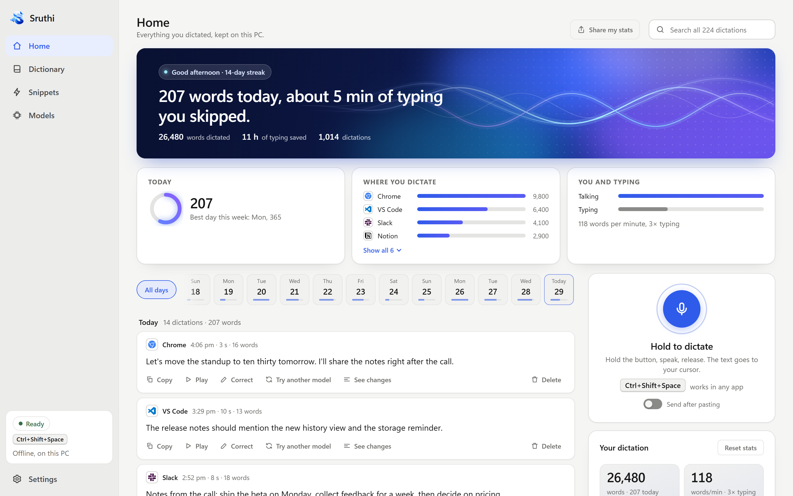
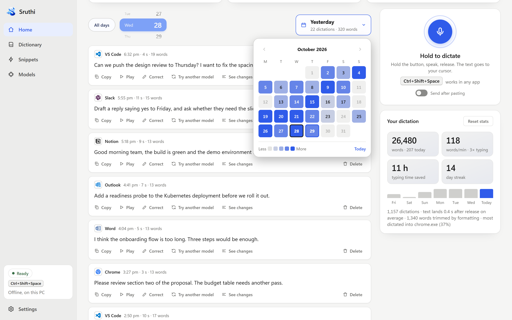
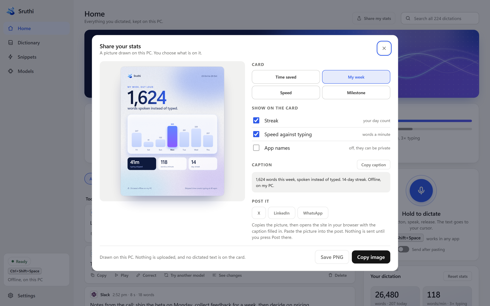
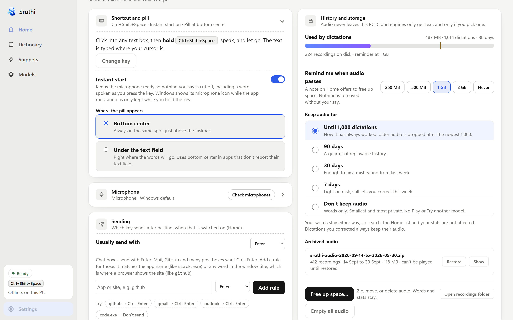
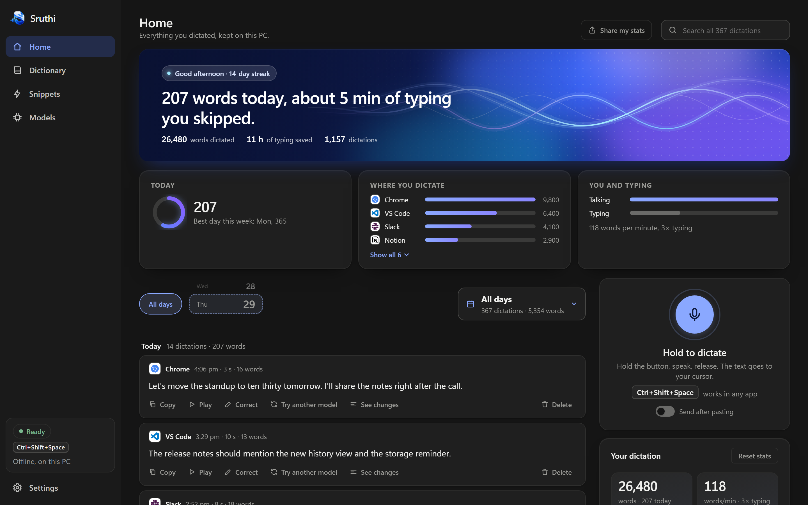

# Sruthi

**Offline voice dictation for your PC.**
Hold a key, speak, let go. Your words are typed wherever your cursor is, and your voice never leaves the machine.

[**Download**](https://github.com/iamjustkrishna/Sruthi/releases/latest) ·
[Features](#features) ·
[Speech models](#choose-your-speech-model) ·
[Privacy](#privacy) ·
[FAQ](#faq)

  

## Why Sruthi

Most of us speak two to three times faster than we type, yet most dictation tools send your voice to someone else's server. Sruthi does the listening on your own computer.

- **Private by design.** Recording, transcription and clean-up all happen on your PC. No account, no telemetry, nothing uploaded.
- **Works in every app.** Browser, editor, chat, email, a terminal. If it has a text box, Sruthi can type into it.
- **Yours to keep.** Free, open source, and every dictation stays on your disk for you to replay, correct and search.

*Śruti* is Sanskrit for "that which is heard."

## Get started

1. **Install** the latest version from the [releases page](https://github.com/iamjustkrishna/Sruthi/releases/latest).
2. **Pick a speech model** on first launch. It downloads once, then everything works without the internet.
3. **Click into any text box, hold the shortcut, speak, and let go.** The text appears at your cursor.

The default shortcut is <kbd>Ctrl</kbd> + <kbd>Shift</kbd> + <kbd>Space</kbd>, and you can change it in Settings. You can also hold the big microphone button in the app.

## Features

### Dictate anywhere

- **Hold to talk.** A global shortcut works in any app. A small pill near your text field shows when Sruthi is listening, and a check when your words are ready.
- **Instant start.** The microphone stays ready, so nothing you say is cut off, even the word you spoke as you pressed the key.
- **No text box? No problem.** If nothing can take typing, Sruthi shows your text in a small card with a Copy button instead of losing it.
- **Send after pasting.** Turn it on and Sruthi presses the send key for you, so a chat message goes out or a search runs the moment you let go. Choose Enter, Ctrl+Enter, Shift+Enter or Alt+Enter, and set it differently per app or website (Enter for chat, Ctrl+Enter for GitHub and mail).

### Text that reads well

- **Smart formatting.** Numbers, dates, spoken punctuation and self-corrections ("two, no, three") are cleaned up for you, and if an AI rewrite ever drifts from what you said, Sruthi falls back to the plain rules-based clean-up. Everything runs offline by default.
- **Fits where you are.** Email, chat, documents and code editors each get text shaped to suit them.
- **Personal dictionary.** Names and product terms spelled exactly the way you say them. Sruthi suggests words from what you corrected, and shows where your dictionary fixed a mishearing.
- **Snippets.** Say a short phrase and get a whole block of text: your email sign-off, a standup template, a bug report.
- **Hinglish.** Dedicated models type mixed Hindi and English the way you speak it: "Main aaj subah office ja raha hoon."
- **Your own cloud AI, if you want it.** Optionally route clean-up through Gemini, Groq or Claude with your own key. Only text is sent, never audio, and if it can't be reached the local model takes over.

### Everything you said, day by day

  

- **A home for every dictation.** See what you said, which app it went into and when. Step through days with a small wheel, pick a date from a heat calendar, or search across all of it.
- **Replay and correct.** Listen to any recording, fix a mishearing, or run it through another model to compare. See exactly what formatting changed.
- **Your speed, honestly measured.** Words, words per minute against typing, time saved, streaks and the apps you dictate into.
- **A speed test on your own voice.** Correct a few dictations and Sruthi scores each installed model against what you actually said.

### Share your stats

  

Make a picture of your own numbers: **Time saved**, **My week**, **Speed** or a **Milestone** card. They are drawn on your PC, you choose what appears (streak, speed, app names), and no dictated text is ever on them. Save as a PNG, copy the image, or open X, LinkedIn or WhatsApp with a caption ready to paste.

### In control of your storage

  

Audio takes space, so you decide what stays: keep it for 90, 30 or 7 days, or not at all. Sruthi reminds you when audio passes a size you choose, and **Free up space** can zip it, move it to another drive, or delete it. Your words and stats always stay.

### Made for daily use

  

- **Runs on your graphics card** for the larger models, with an automatic fall back to the CPU and a clear note about where it is running.
- **Microphone check** finds out whether a microphone is actually delivering sound.
- **Light and dark themes** that follow your system, and a tray icon so it stays out of your way.

## Choose your speech model

Models download once on first use into your user data folder and are never bundled with the app. Switch any time from the Models page.

| Model | Size | Best for |
| --- | --- | --- |
| **Parakeet V3** (recommended) | ≈ 478 MB | English and 24 European languages. Best all-round accuracy. |
| Parakeet V2 | ≈ 631 MB | English only, slightly more accurate on English. |
| Hybrid: Parakeet + Whisper | ≈ 478 MB + 806 MB | Parakeet's speed, with a second pass for whispers and missed words. |
| Whisper Large v3 Turbo | ≈ 806 MB | Whispers, accents and rare words. |
| Whisper Hinglish Apex | ≈ 806 MB | Mixed Hindi and English, typed in Roman letters. |
| Whisper Hinglish Swift | ≈ 57 MB | A small, quick Hinglish model. |
| Whisper Tiny | ≈ 75 MB | Quick everywhere, rough results. |
| Moonshine Base / Tiny | ≈ 55 / 31 MB | The smallest English models, for busy or older PCs. |

Each model keeps its own license. Check the license on its download page.

## Install

| Platform | File | Notes |
| --- | --- | --- |
| Windows 10 / 11 (64-bit) | `.exe` or `.msi` | Primary platform. Everything in this page works here. |
| macOS 12+ (Apple Silicon) | `.dmg` | Early support, Apple Silicon only (Intel Macs are not supported yet). Dictation works, but features that need to know which app you are in (per-app tone, the app list and logos, per-app send keys) are Windows-only for now. The app is unsigned: right-click it and choose **Open** on first launch, or allow it in System Settings → Privacy & Security. |

Download from the [latest release](https://github.com/iamjustkrishna/Sruthi/releases/latest). Using a graphics card for the larger models is optional: see [docs/GPU.md](docs/GPU.md).

## Privacy

Sruthi is built so you don't have to take its word for it.

- **Your voice stays on your PC.** Recording, transcription and formatting run locally by default.
- **No telemetry. No account.** There is nothing to sign in to and nothing is reported back.
- **The only times it touches the internet:**
  - downloading a speech model, once, when you choose it;
  - clean-up through a cloud provider, *only if you add your own key*, and then only the text;
  - the Share sheet's X, LinkedIn and WhatsApp buttons, which open your browser with just the caption in the link. The picture stays on your PC until you paste it.
- **Your data is yours.** Recordings, history and stats live in a folder on your PC. You can reveal, zip, move or delete them from Settings at any time. API keys are kept in the system credential store.

## FAQ

**Does it really work offline?**
Yes. After a model is downloaded, dictation needs no internet at all.

**Windows says "Windows protected your PC". Is that safe?**
The installer is not code-signed yet, so Windows shows this for any new app from an independent developer. Choose **More info**, then **Run anyway**. The source is public if you would like to check it or build it yourself.

**Where is my data?**
In your user data folder (`%LOCALAPPDATA%\Sruthi` on Windows). Saved share cards go to `Pictures\Sruthi` and zipped audio to `Documents\Sruthi`. Open the recordings folder from Settings → History and storage.

**How do I remove everything?**
Settings → History and storage → **Empty all audio** removes your recordings, and deleting the Sruthi data folder removes everything else.

**Why does Windows show a microphone icon while Sruthi runs?**
That's Instant start keeping the microphone ready so your first word is never missed. Audio is only kept while you hold the key, and you can turn Instant start off in Settings.

**Which model should I pick?**
Start with **Parakeet V3**. Move to a Whisper model for whispers and rare words, or a Hinglish model for mixed Hindi and English.

**Does it work in my language?**
Parakeet V3 covers English and 24 European languages, Whisper models cover many more, and the Hinglish models handle Hindi and English together.

**What license is Sruthi under?**
The GNU GPL v3 or later. It is free to use, and anyone who distributes a modified version has to share the source under the same terms. Earlier versions (0.4.0 and before) stay available under MIT.

**Is it as good as the cloud services?**
It's close for everyday dictation, and it improves with your dictionary and corrections. The Models page has a speed test that scores each installed model on your own voice, so you can see for yourself.

## Acknowledgements

Sruthi stands on open work: the Parakeet speech models from NVIDIA, Whisper from OpenAI, the Moonshine models from Useful Sensors, and the open-source engines that run them. App logos on Home are from [Simple Icons](https://simpleicons.org). Every model and asset keeps its own license.

## Roadmap

Where Sruthi is headed is in [PLAN.md](PLAN.md). Ideas and bug reports are welcome in the [issue tracker](https://github.com/iamjustkrishna/Sruthi/issues).

## Contributing

Contributions are welcome. [CONTRIBUTING.md](CONTRIBUTING.md) covers the project layout, how to build and test, the commit conventions and a short contributor agreement.

## License

Sruthi is free software under the [GNU General Public License v3.0 or later](LICENSE). You can use it, study it, change it and share it. If you distribute a modified version, you must share its source under the same license.

Versions 0.4.0 and earlier were released under the MIT license and remain available under it. If you want to use Sruthi in a way the GPL doesn't allow, open an issue to talk about a separate license.

The speech models are downloaded at runtime and stay under their own licenses. Libraries Sruthi builds on, and the terms they come under, are listed in [THIRD_PARTY_NOTICES.md](THIRD_PARTY_NOTICES.md).

Made for people who think faster than they type.

